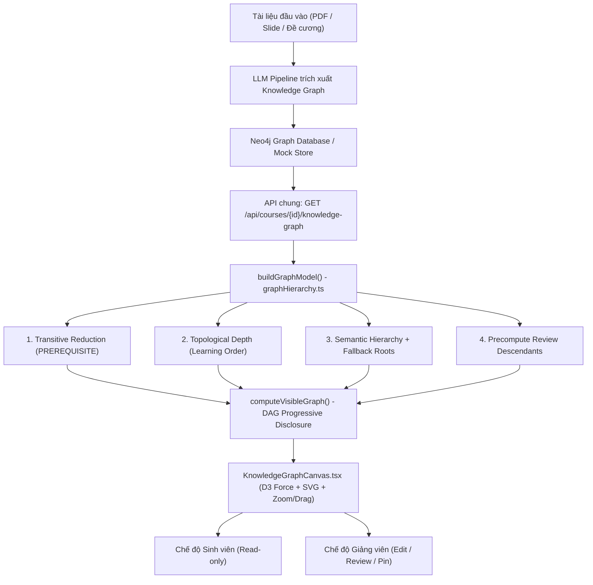

# Tài liệu Thiết kế UI/UX, Nền tảng Lý thuyết và Thuật toán Hiển thị Đồ thị Tri thức (Knowledge Graph)

Tài liệu này mô tả đầy đủ nền tảng lý thuyết **HCI / UI-UX / Information Visualization**, **hợp đồng dữ liệu (Ontology)** và **toàn bộ hệ thống thuật toán** đang vận hành trong module Đồ thị Tri thức của hệ thống **Learning Support Tutor System (G4LMS)**.

- Mã nguồn triển khai lõi:
  - Engine phân cấp & thuật toán đồ thị: `frontend/src/features/graph/graphHierarchy.ts`
  - Engine trực quan hóa D3 & tương tác UI/UX: `frontend/src/features/graph/KnowledgeGraphCanvas.tsx`
  - Lớp tích hợp thống nhất Giảng viên / Sinh viên: `frontend/src/features/graph/UnifiedCourseGraph.tsx`
  - API Neo4j dùng chung: `backend/app/api/routes/learning_graph.py`

---

## 1. Bối cảnh bài toán & Yêu cầu thiết kế

### 1.1. Đặc thù của đồ thị tri thức sinh tự động bởi AI / LLM
Trong hệ thống G4LMS, đồ thị tri thức của mỗi môn học được trích xuất tự động từ tài liệu đầu vào (đề cương, slide bài giảng, ngân hàng bài tập) bằng LLM và lưu trữ trên cơ sở dữ liệu đồ thị Neo4j. Do đặc thù dữ liệu sinh tự động, đầu vào cho giao diện có các thách thức sau:

1. **Cấu trúc và quy mô biến thiên ngẫu nhiên theo tài liệu**: một môn có thể chỉ gồm 20 nút, trong khi môn có nhiều slide (như *Mạng máy tính – CO3093*) có thể lên tới **1.255 nút** và **1.269 cạnh**.
2. **Không có tọa độ $(x, y)$ dựng sẵn**: LLM chỉ sinh quan hệ ngữ nghĩa, không sinh bố cục hình học.
3. **Đồ thị tổng quát (General Directed Graph / Multi-parent DAG), không phải cây thuần**:
   - Một khái niệm (`Concept`) có thể góp phần đạt nhiều chuẩn đầu ra (`LO`) cùng lúc (*đa cha*).
   - LLM có thể sinh **cạnh tiên quyết dư thừa** ($A \to B \to C$ và thêm $A \to C$), **chu trình** ($A \to B \to A$), **nút mồ côi** (không nối vào nhánh nào), hoặc một nút cha chứa hàng chục nút con.
4. **Độ bất định của AI (Human-in-the-Loop)**: một số nút/quan hệ do LLM đề xuất có trạng thái `proposed` hoặc `confidence < 0.8`, đòi hỏi giảng viên rà soát và phê duyệt trước khi xác nhận chính thức.

### 1.2. Mục tiêu UI/UX
- **Một cấu trúc đồ thị duy nhất cho cả Giảng viên và Sinh viên**: đồng nhất mô hình tư duy (*mental model*), chỉ phân tách quyền chỉnh sửa (*read-only* với sinh viên, *editable & review* với giảng viên).
- **Tổng quát hóa hoàn toàn ở Frontend**: không hardcode tên môn học, mã nút hay tọa độ; mọi đồ thị tuân thủ đúng schema đều tự động phân cấp và hiển thị mượt mà.
- **Chống hiệu ứng "búi tóc rối" (Hairball Effect)**: không đổ toàn bộ hàng trăm/hàng nghìn nút ra màn hình ngay lúc mới tải; cho phép khám phá tăng dần theo nhu cầu (*expand-on-demand*).

---

## 2. Nền tảng Lý thuyết UI/UX & Trực quan hóa Dữ liệu (Information Visualization)

Phần này tổng hợp các học thuyết nền tảng làm cơ sở khoa học cho từng quyết định thiết kế giao diện.

### 2.1. Visual Information-Seeking Mantra (Shneiderman, 1996)
Ben Shneiderman đề xuất nguyên lý kinh điển cho hệ thống trực quan hóa dữ liệu phức tạp:
> **"Overview first, zoom and filter, then details-on-demand."**

Hệ thống ánh xạ trực tiếp 4 pha của nguyên lý này lên bố cục màn hình:

| Pha lý thuyết | Thành phần giao diện tương ứng | Vai trò UX |
|---|---|---|
| **Overview first** | Hiển thị mặc định tầng gốc (**Bậc 1: `Course` + `LO`**) và thanh chip tổng quan `Loại nút` / `Loại quan hệ` kèm số lượng | Người dùng nắm ngay bức tranh toàn môn học (~14 nút) thay vì choáng ngợp bởi >250 nút |
| **Zoom and filter** | Zoom/Pan/Fit bằng con lăn & cụm nút `+/−/Fit`, bật/tắt chip từng loại nút & cạnh, checkbox `Ẩn cạnh dư`, `Theo thứ tự học`, ô tìm kiếm (`/`) | Giảm nhiễu tức thì theo mục đích (chỉ xem tiên quyết, chỉ xem phần cần duyệt, hoặc lọc slide) |
| **Expand-on-demand** | Nhãn `+N` / `−`, click mở nhánh, nút ảo `+N nữa` | Kiểm soát độ sâu khám phá theo từng nhánh riêng lẻ |
| **Details-on-demand** | Bảng thuộc tính (Inspector) bên phải khi chọn nút hoặc cạnh | Không nhồi mô tả dài, độ tin cậy, lý do AI hay danh sách quan hệ lên canvas chính |

### 2.2. Progressive Disclosure & Cognitive Load Theory
- **Cognitive Load Theory (John Sweller, 1988)**: Bộ nhớ làm việc (*working memory*) của con người có dung lượng hạn chế; khi số lượng phần tử thị giác vượt ngưỡng (đặc biệt trên 30–50 nút giao cắt cạnh), **tải nhận thức ngoại lai (*extraneous cognitive load*)** tăng vọt khiến người học không thể tập trung vào kiến thức cốt lõi (*germane load*).
- **Progressive Disclosure (Jakob Nielsen / Nielsen Norman Group)**: Chỉ trình bày thông tin thiết yếu ở tầng đầu và hé lộ chi tiết theo hành động chủ động của người dùng.
- **Hick-Hyman Law**: Thời gian ra quyết định tăng theo logarit số lượng lựa chọn $T = b \cdot \log_2(n + 1)$. Việc thu gọn từ **285 nút khái niệm/LO/bài tập** (và 970 slide) xuống còn **14 nút gốc** + phân trang tối đa **12 nút con/lần mở** giữ số lựa chọn đồng thời luôn trong vùng xử lý dễ chịu.

### 2.3. Bảo toàn Bản đồ Tư duy (Mental Map Preservation)
Theo **Misue et al. (1995)** và **Purchase et al. (2006)**, khi đồ thị động thay đổi (thêm/ẩn nút), nếu toàn bộ nút cũ bị tái bố cục ngẫu nhiên, người dùng mất hoàn toàn định hướng không gian (*loss of mental map*) và phải đọc lại đồ thị từ đầu.

Hệ thống giải quyết bằng 3 kỹ thuật:
1. **Lưu bền tọa độ cũ** (`posMapRef`) xuyên suốt các lần mở/thu gọn.
2. **Spawn cục bộ quanh nút cha (`spawnAnchor`)**: nút con mới xuất hiện xếp thành vòng tròn đều quanh tọa độ $(x_p, y_p)$ của nút cha vừa bấm.
3. **Năng lượng mô phỏng thấp (`alpha = 0.32`)**: khi mở rộng nhánh chỉ tạo lực đẩy nhẹ để tách va chạm thay vì chạy lại toàn bộ hệ lực ở `alpha = 0.9` và không tự động reset góc nhìn camera (`autoFit = false`).

### 2.4. Affordance, Signifiers & Preattentive Processing
- **Signifiers (Don Norman, 2013)**:
  - Nhãn màu xanh **`+N`** góc dưới-phải nút báo hiệu rõ ràng *"nút này có thể bấm mở để xem thêm $N$ nút con"*; chuyển sang **`−`** màu xám khi đang mở.
  - Đường viền nét đứt màu xanh trên nút ảo **`+N nữa`** phân biệt trực quan giữa **nút điều khiển phân trang** và **nút tri thức thực**.
  - Chấm tròn nhỏ góc trên-phải (`.kg-pin`) báo hiệu nút đã được giảng viên ghim vị trí cố định.
- **Preattentive Visual Attributes (Colin Ware, 2012)**:
  - **Màu sắc (Hue)** mã hóa `node.type` và `edge.type` theo bảng màu có độ tương phản cao (tham chiếu chuẩn Neo4j Browser).
  - **Kích thước (Size)** mã hóa vai trò phân cấp (`Course`: $r=42$, `LO`: $r=34$, `Concept`: $r=30$, `Content`: $r=12$).
  - **Độ mờ (Opacity / Focus + Context)**: khi chọn 1 nút, lân cận bậc 1 giữ `opacity = 1`, phần còn lại giảm còn `opacity = 0.14` (kỹ thuật *Dimming / Spotlight*).
  - **Nét liền vs Nét đứt & Mũi tên**: phân biệt quan hệ có hướng bắt buộc (`PREREQUISITE`, `PART_OF`) với quan hệ liên kết lỏng (`RELATED_TO`).

### 2.5. Human-in-the-Loop AI (HITL) & Explainable AI (XAI) UX
Theo **Amershi et al. (2019) – *Guidelines for Human-AI Interaction*** (Microsoft Research):
- **Make clear why the system did what it did (G11)**: mỗi cạnh do AI sinh hiển thị thanh tiến độ `confidence` ($0 \to 1$), trạng thái (`proposed` / `approved`) và trường giải thích `reason`.
- **Support efficient correction (G9)**: giảng viên có thể bấm **Duyệt quan hệ**, **Duyệt nút**, **Gộp nút trùng**, **Nối cạnh**, hoặc **Xóa** ngay trong bảng thuộc tính / thanh công cụ.
- **Visibility of hidden AI uncertainty**: ngay cả khi nhánh đang thu gọn, một **chấm cam** ở góc trên-trái nút cha cảnh báo giảng viên *"bên trong nhánh này còn mục AI cần duyệt"*, tránh tình trạng dữ liệu cần kiểm duyệt bị che khuất bởi Progressive Disclosure.

### 2.6. Direct Manipulation & Quyền theo Vai trò (RBAC UX)
- **Direct Manipulation (Shneiderman, 1983)**: thao tác trực tiếp trên đối tượng (click mở/đóng, kéo thả ghim, zoom/pan tại vị trí con trỏ, click nút hàng xóm trong Inspector để bay tới ngay).
- **Cùng giao diện, khác quyền tương tác**:
  - **Sinh viên**: chế độ *read-only* (nhãn `Chế độ chỉ xem`), ẩn thanh sửa & chấm cam duyệt AI nội bộ, không kéo ghim nút, bổ sung CTA *Mở tài liệu môn học*.
  - **Giảng viên**: có công tắc **Chế độ chỉnh sửa**, công cụ CRUD/Gộp, kéo ghim nút, chip **Cần duyệt** tự mở đường tới cạnh cam, và nút **Tạo từ PDF**.

---

## 3. Hợp đồng Dữ liệu & Ontology chuẩn hóa

Nguyên tắc cốt lõi để frontend xử lý được **mọi đồ thị ngẫu nhiên từ LLM** là tách biệt:
- **Nội dung động** (số lượng, tên, mô tả, mối nối giữa các nút — thay đổi theo từng file PDF).
- **Ontology cố định** (tập loại nút và loại quan hệ chuẩn hóa ở tầng API `/api/courses/{course_id}/knowledge-graph`).

### 3.1. JSON Schema đầu vào chuẩn
```ts
interface KnowledgeGraphData {
  nodes: {
    id: string;
    name: string;
    type: 'Course' | 'LO' | 'Concept' | 'Assignment' | 'Item' | 'Content';
    description?: string;
    properties?: Record<string, unknown>; // code, chapter_id, page, status, merged_from...
  }[];
  edges: {
    source: string;
    target: string;
    type: 'PREREQUISITE' | 'PART_OF' | 'RELATED_TO' | 'DEVELOP' | 'EXPLAIN' | 'ASSESS';
    properties?: Record<string, unknown>; // confidence, status, reason, review_group...
  }[];
}
```

### 3.2. Bảng quy chuẩn trực quan theo Ontology

| Loại nút (`node.type`) | Ý nghĩa | Màu nền | Bán kính $r$ (px) | Tầng mặc định |
|---|---|---|---|---|
| `Course` | Môn học gốc | `#FFD86E` (Vàng) | 42 | Bậc 1 (hiện sẵn) |
| `LO` | Chuẩn đầu ra (*Learning Outcome*) | `#6DCE9E` (Xanh lục) | 34 | Bậc 1 (hiện sẵn) |
| `Concept` | Khái niệm kiến thức (gốc & con) | `#68BDF6` (Xanh dương) | 30 | Bậc 2–3 (mở theo nhu cầu) |
| `Assignment` | Bài tập / Đồ án / Kiểm tra | `#FF756E` (Đỏ san hô) | 32 | Bậc 2–3 |
| `Item` | Câu hỏi đánh giá chi tiết | `#F79767` (Cam) | 26 | Bậc 3 |
| `Content` | Trang slide / tài liệu nguồn | `#C9CDD4` (Xám) | 12 | Bậc 4 (ẩn mặc định qua chip) |

| Loại cạnh (`edge.type`) | Ý nghĩa | Mapping từ Neo4j | Màu & Kiểu nét | Chiều dài lực $d$ |
|---|---|---|---|---|
| `PREREQUISITE` | Tiên quyết ($A$ học trước $B$) | `REQUIRES`, `PREREQUISITE` | `#46556f`, nét liền, có mũi tên | 130 px |
| `PART_OF` | Quan hệ thành phần (con $\to$ cha) | `PART_OF`, `IN_CLUSTER` | `#1f9d68`, nét liền dày, mũi tên | 100 px |
| `DEVELOP` | Đóng góp vào mục tiêu (`Concept/LO/Assignment` $\to$ `LO/Course`) | `ALIGNS_WITH`, `DEVELOP` | `#9b6bd1`, nét liền, mũi tên | 150 px |
| `RELATED_TO` | Liên hệ chéo bổ trợ | `RELATED`, `RELATED_TO`, `CONCEPT` | `#8e98a8`, nét đứt `5 4`, không mũi tên | 150 px |
| `ASSESS` | Đánh giá năng lực khái niệm | `HAS_QUIZ`, `ASSESS` | `#f08a4b`, nét liền, mũi tên | 95 px |
| `EXPLAIN` | Tài liệu giải thích khái niệm | `HAS_RESOURCE`, `EXPLAIN` | `#b4bac5`, nét mảnh, mũi tên | 65 px |

---

## 4. Kiến trúc tổng thể & Luồng xử lý dữ liệu



---

## 5. Chi tiết Hệ thống Thuật toán Cốt lõi

Gọi đồ thị đầu vào là $G = (V, E)$, trong đó $V$ là tập nút đã khử trùng theo `id` và $E \subseteq V \times V \times T_E$ là tập cạnh có hướng gắn nhãn loại quan hệ.

---

### 5.1. Thuật toán 1: Khử cạnh tiên quyết dư thừa (Transitive Reduction trên `PREREQUISITE`)

**Bài toán**: LLM thường trích xuất đồng thời $A \to B$, $B \to C$ và $A \to C$. Cạnh trực tiếp $A \to C$ không bổ sung thông tin thứ tự mới nhưng làm rối đồ thị do tăng số cạnh cắt nhau.

**Định nghĩa**: Một cạnh tiên quyết $e = (u, v) \in E_{\text{prereq}}$ được đánh dấu `redundant = true` nếu và chỉ nếu trong đồ thị con tiên quyết sau khi loại bỏ cạnh $e$, vẫn tồn tại đường đi có hướng từ $u$ tới $v$:
$$\text{redundant}(u, v) \iff v \in \text{Reachable}_{G_{\text{prereq}} \setminus \{(u, v)\}}(u)$$

**Thuật toán** (`reachablePrereq` trong `graphHierarchy.ts`):
```text
Hàm isRedundant(u, v, skipEdge):
  seen ← { u }, stack ← [ u ]
  Trong khi stack khác rỗng:
    cur ← stack.pop()
    Với mỗi cạnh e = (cur → w) trong outPrereq[cur]:
      Nếu e == skipEdge: tiếp tục
      Nếu w == v: trả về TRUE
      Nếu w chưa thuộc seen:
        seen.add(w)
        stack.push(w)
  Trả về FALSE
```

- **Độ phức tạp**: $O(|E_p| \cdot (|V| + |E_p|))$, với $|E_p|$ là số cạnh `PREREQUISITE` (thực tế $|E_p| \ll |E|$, VD môn CO3093 chỉ có 26 cạnh tiên quyết nên chạy dưới 1 ms).
- **Lợi ích UX**: Giữ lại cạnh dư trong dữ liệu gốc (người dùng có thể bỏ tick `Ẩn cạnh dư` để kiểm tra), nhưng mặc định ẩn đi để đường học tập sạch và rõ mạch.

---

### 5.2. Thuật toán 2: Tính độ sâu theo Thứ tự học (Cycle-safe Topological Longest-Path Depth)

**Bài toán**: Khi người dùng bật checkbox **Theo thứ tự học**, các khái niệm cần tự động sắp xếp từ trái sang phải theo chiều tiến triển kiến thức (tiên quyết ở bên trái, khái niệm phụ thuộc ở bên phải, cuối cùng là `LO` và `Course`).

**Công thức đệ quy có phát hiện chu trình**:
$$\text{depth}(v) = \begin{cases} 0 & \text{nếu } \text{inPrereq}(v) = \emptyset \text{ hoặc phát hiện chu trình} \\ \max\limits_{(u \to v) \in E_{\text{prereq}}} \big(\text{depth}(u) + 1\big) & \text{ngược lại} \end{cases}$$

Sau khi tính xong `depth` cho toàn bộ `Concept` và `Assignment`, lan truyền sang tầng mục tiêu:
- Với mọi cạnh `Concept(u) -[DEVELOP]-> LO(v)`: $\text{depth}(v) \leftarrow \max(\text{depth}(v), \text{depth}(u) + 1)$.
- Với mọi cạnh `LO(u) -[DEVELOP]-> Course(v)`: $\text{depth}(v) \leftarrow \max(\text{depth}(v), \text{depth}(u) + 1)$.

**Xử lý an toàn chu trình**: Dùng tập `stack` lưu các nút đang nằm trên nhánh đệ quy hiện tại; nếu gặp lại $v \in \text{stack}$, trả về `0` thay vì đệ quy vô hạn.
- **Độ phức tạp**: $O(|V| + |E|)$ nhờ memoization vào bảng `depth`.

---

### 5.3. Thuật toán 3: Suy luận Phân cấp Ngữ nghĩa Động & Chuỗi Fallback An toàn cho LLM

Đây là thuật toán quan trọng nhất giúp **một bộ code cố định chạy đúng với mọi đồ thị AI ngẫu nhiên**.

#### Bước 1 – Lọc nút con theo ngữ nghĩa (`childrenOf` & `parentsOf`)
Thay vì duyệt BFS mù quáng theo khoảng cách, quan hệ cha $\to$ con mở rộng được xây dựng theo luật ngữ nghĩa:

1. `LO -[DEVELOP]-> Course` $\implies$ `Course` là cha mở rộng của `LO`.
2. `Concept(s) -[DEVELOP]-> LO(t)`:
   - Kiểm tra xem $s$ có thuộc quan hệ `PART_OF` tới một khái niệm cha $p$ mà $p$ cũng `DEVELOP -> t` hay không (`hasParentInSameLo`).
   - **Chỉ gắn $s$ trực tiếp dưới `LO(t)` nếu `hasParentInSameLo == false`**.
   - *Ý nghĩa*: Trên dữ liệu thực tế `CO3093`, `LO3.1` nối với 41 khái niệm, nhưng sau khi lọc qua `PART_OF` chỉ còn **5 khái niệm chủ đề gốc**. Khi bấm `LO3.1`, người dùng thấy 5 chủ đề lớn trước; bấm tiếp từng chủ đề mới bung các khái niệm chi tiết bên trong.
3. `Concept(s) -[PART_OF]-> Concept(t)` $\implies$ `t` là cha mở rộng của `s`.
4. `Concept(s) -[PREREQUISITE (không dư) | RELATED_TO]-> Concept(t)` $\implies$ `s` có thể mở sang `t`.
5. `ASSESS` $\implies$ `Concept` mở sang `Assignment` / `Item`.
6. `Content(s) -[EXPLAIN]-> Target(t)` $\implies$ `t` mở sang `Content` (tầng cuối).

#### Bước 2 – Chọn tập nút gốc Bậc 1 (`roots`) với 3 tầng Fallback
Để không bao giờ xảy ra lỗi trắng màn hình nếu tài liệu PDF không có đề cương (`LO`) hoặc thiếu nút `Course`:

| Thứ tự ưu tiên | Điều kiện dữ liệu AI | Tập `roots` được chọn |
|---|---|---|
| **Mức 1 (Chuẩn)** | Có ít nhất 1 nút `LO` | Toàn bộ `Course` + toàn bộ `LO` |
| **Mức 2 (Thiếu LO)** | Không có `LO`, có `Course` | `Course` + tối đa 12 `Concept` gốc (không có cạnh ra `PART_OF`) |
| **Mức 3 (Đồ thị phẳng / tự do)** | Không có `Course` lẫn `LO` | Các nút gốc không có `PART_OF` (nếu $\le 20$ nút), ngược lại lấy Top-10 nút có bậc (`degree`) cao nhất |

#### Bước 3 – Bảo toàn nút mồ côi (Unreachable Safeguard)
Chạy BFS từ `roots` theo `childrenOf` thu được tập `reachableFromRoots`. Với mọi nút $v \notin \text{reachableFromRoots}$ (trừ `Content`):
- Ưu tiên gắn các nút không có cha `PART_OF` vào `primaryRoot` (thường là nút `Course`), rồi lan truyền BFS để cả cây con của chúng cũng trở thành khả đạt.
- Các nút còn sót (như cụm chu trình khép kín) cũng được gắn vào `primaryRoot`.
- **Đảm bảo toán học**: $100\%$ nút kiến thức AI sinh ra đều có đường đi từ `roots`, không bao giờ bị "mất tích" khi thu gọn.

#### Bước 4 – Sắp xếp con tiền định (Deterministic Child Ordering)
Danh sách `childrenOf[p]` được sắp xếp theo khóa ưu tiên từ điển:
$$(\text{typePriority}(c),\; \text{chapter\_id}(c),\; \text{depth}(c),\; \text{name}(c))$$
Nhờ đó thứ tự xuất hiện của các nút con luôn nhất quán theo chương và trình tự học, đặc biệt hữu ích khi kết hợp với phân trang 12 nút/đợt.

---

### 5.4. Thuật toán 4: Progressive Disclosure trên DAG nhiều cha & Phân trang Đồ thị (`computeVisibleGraph`)

#### Trạng thái điều khiển
- `showAll: boolean` — `false` (chế độ Progressive mặc định) hoặc `true` (chế độ Mở tất cả).
- `expanded: Set<string>` — tập ID các nút đang được người dùng mở rộng.
- `pageLimits: Map<string, number>` — số nút con tối đa đang hiển thị của từng nút cha (mặc định `DEFAULT_CHILD_PAGE_SIZE = 12`).
- `hiddenNodeTypes: Set<string>` — mặc định `{'Content'}` để ẩn hàng trăm slide cho tới khi người dùng bật chip `Content`.

#### Quy tắc hiển thị bất biến (Fixed-Point Propagation trên DAG)
Khác với cây đơn cha (thu gọn cha là xóa toàn bộ cây con), trên đồ thị nhiều cha một `Concept` có thể đồng thời thuộc `LO1` và `LO2`. Tập nút hiển thị $V_{\text{vis}}$ được tính theo vòng lặp điểm bất động:

1. Khởi tạo: $V_{\text{vis}} \leftarrow \{ r \in \text{roots} \mid \text{type}(r) \notin \text{hiddenNodeTypes} \}$.
2. Lặp cho tới khi $V_{\text{vis}}$ không tăng thêm:
   - Với mỗi $p \in \text{expanded}$ thỏa $p \in V_{\text{vis}}$:
     - Lấy danh sách con hợp lệ $C(p) = [c \in \text{childrenOf}(p) \mid \text{type}(c) \notin \text{hiddenNodeTypes}]$.
     - Lấy lát cắt phân trang $S(p) = C(p)[0 \dots \text{limit}(p)-1]$.
     - Với mỗi $c \in S(p)$: nếu $c \notin V_{\text{vis}}$, thêm $c$ vào $V_{\text{vis}}$ và ghi nhận `spawnAnchor[c] = p`.

**Tính chất quan trọng**:
- Nếu `Concept X` thuộc cả `LO1` và `LO2`, khi mở cả hai rồi thu gọn `LO1`, `X` vẫn thuộc $S(\text{LO2})$ nên **không bị biến mất ngoài ý muốn**.
- Nếu thu gọn nút cha $A$, toàn bộ hậu duệ chỉ phụ thuộc duy nhất vào $A$ tự động ẩn đi mà không cần xóa thủ công từng nút con khỏi `expanded`.

#### Phân trang bằng nút ảo `+N nữa`
Nếu với một nút cha đang mở $p \in \text{expanded} \cap V_{\text{vis}}$ mà $|C(p)| > \text{limit}(p)$, thuật toán tự sinh một nút ảo `id = "__more__" + p`:
- Nhãn: `+{remaining} nữa`, kiểu `More` (viền nét đứt màu xanh).
- Khi người dùng bấm nút này: $\text{limit}(p) \leftarrow \text{limit}(p) + 12$.
- Tránh triệt để hiện tượng một chương/LO lớn bung ra 50–100 nút cùng lúc làm vỡ bố cục.

#### Tính cạnh hiển thị & nhãn `+N`
- **Cạnh hiển thị**: chỉ vẽ cạnh $(u, v)$ khi $u \in V_{\text{vis}} \land v \in V_{\text{vis}} \land \text{type}(e) \notin \text{hiddenEdgeTypes} \land \neg(\text{hideRedundant} \land e.\text{redundant})$.
- **Nhãn `+N` trên nút $u$**:
  $$\text{hiddenChildCount}(u) = \big|\{ c \in C(u) \mid c \notin V_{\text{vis}} \}\big|$$
  - Nếu $\text{hiddenChildCount}(u) > 0$: hiển thị badge xanh **`+N`**.
  - Nếu $\text{hiddenChildCount}(u) = 0$ nhưng $u \in \text{expanded}$ và $|C(u)| > 0$: hiển thị badge xám **`−`**.
  - Ngược lại (nút lá): ẩn badge.

---

### 5.5. Thuật toán 5: Lan truyền Cảnh báo Duyệt AI (`reviewDescendantCount`)

**Bài toán**: Trong chế độ thu gọn, các cạnh cam (cần giảng viên duyệt) nằm sâu ở bậc 2–3 đang bị ẩn. Nếu không báo hiệu, giảng viên không biết nhánh nào đang chứa đề xuất AI chưa duyệt.

**Giải pháp**: Chạy tiền xử lý 1 lần khi tải đồ thị (`buildGraphModel`):
- Đánh dấu mỗi nút $u$ có `needsReview = true` (trạng thái `proposed`/`draft`/`pending_review`) hoặc kề cạnh có `review = true`.
- Với mỗi nút $v \in V$, chạy BFS có tập `visited` (chống chu trình) duyệt toàn bộ hậu duệ theo `childrenOf` để đếm tổng số hậu duệ cần duyệt `reviewDescendantCount[v]`.
- Trên UI (chỉ hiển thị với vai trò **Giảng viên**): vẽ chấm cam `.kg-review-dot` ở góc trên-trái nút $v$ khi `needsReview(v)` hoặc `hiddenChildCount(v) > 0 && reviewDescendantCount(v) > 0`.

---

### 5.6. Thuật toán 6: Tìm kiếm & Duyệt tự động mở đường (Reverse-BFS Path Expansion)

**Bài toán**: Khi 95% nút đang ẩn trong chế độ Progressive, nếu người dùng gõ tìm một khái niệm ở bậc 3 hoặc bấm vào một nút lân cận trong Inspector hoặc bấm chip **Cần duyệt**, nút đích có thể chưa có trên canvas.

**Thuật toán (`findAncestorPath` & `revealNode`)**:
1. Tìm kiếm trên **toàn bộ $V$** (không chỉ $V_{\text{vis}}$).
2. Khi người dùng chọn nút đích $t \notin V_{\text{vis}}$:
   - Nếu `type(t)` đang bị ẩn bởi chip lọc (VD `Content`), tự động bật lại chip đó.
   - Chạy **Reverse-BFS** bắt đầu từ $t$, đi ngược theo danh sách `parentsOf` cho tới khi chạm nút gốc $r \in \text{roots}$ đầu tiên (đảm bảo số nút phải mở thêm là **ít nhất**).
   - Truy ngược mảng `parentTrace` để thu chuỗi cha $[r, p_1, p_2, \dots, p_k]$ dẫn tới $t$.
   - Thêm toàn bộ $\{r, p_1, \dots, p_k\}$ vào `expanded`.
   - **Tự động nới giới hạn phân trang**: với từng cặp liên tiếp $(p_i, c_{i+1})$ trên chuỗi đường đi, kiểm tra chỉ số `idx` của $c_{i+1}$ trong `childrenOf[p_i]`; nếu `idx >= limit(p_i)` thì nâng `limit(p_i)` lên bội số gần nhất của 12 lớn hơn `idx`.
   - Đặt `pendingFocusId = t` → sau 180 ms (khi lực vừa đặt tọa độ cho $t$), camera mượt mà pan & zoom tới giữa nút $t$ (`focusOnNode`).
- **Độ phức tạp**: $O(|V| + |E|)$ cho mỗi lần truy vết.

---

### 5.7. Thuật toán 7: Bố cục Lực Tăng dần (Incremental Force-Directed Layout)

Hệ thống sử dụng mô phỏng vật lý **Velocity Verlet** của D3 (`d3-force`), mở rộng mô hình **Fruchterman-Reingold (1991)** với xấp xỉ **Barnes-Hut Quadtree (1986)** cho lực đẩy tĩnh điện:

| Thành phần lực | Cấu hình triển khai | Vai trò hình học |
|---|---|---|
| **Lực liên kết (`forceLink`)** | $d = \text{edgeStyle.dist}$ (65–150 px), độ cứng $k \in [0.14, 0.48]$ | Kéo các nút có quan hệ lại gần theo cự ly đặc trưng từng loại cạnh |
| **Lực đẩy nhiều vật (`forceManyBody`)** | Cường độ `-380` (nút thường), `-140` (nút `+N nữa`), `-45` (slide), `distanceMax = 560` | Đẩy các nút tách đều nhau, độ phức tạp $O(|V|\log|V|)$ nhờ Barnes-Hut |
| **Lực chống chồng lấn (`forceCollide`)** | Bán kính $r_i + 18\text{ px}$, `strength = 0.95` | Đảm bảo không bao giờ có hai hình tròn đè chữ lên nhau |
| **Lực định hướng trục X (`forceX`)** | Khi bật `orderMode`: kéo về $x_{\text{target}}(v) = \text{depth}(v) \cdot 175 - \text{half}$ | Tạo dòng chảy học tập trái $\to$ phải mà vẫn giữ độ mềm tự nhiên của đồ thị |
| **Xếp hàng nút cô lập (`iso`)** | Các nút bậc 0 trong khung nhìn hiện tại xếp thành lưới 8 cột ở vùng dưới ($y \ge 300$) | Ngăn các nút không có cạnh trôi ra ngoài vô cực |

**Chiến lược giảm giật & bảo toàn Mental Map**:
- Lần tải đầu tiên hoặc khi bấm **Sắp xếp lại**: khởi động mô phỏng ở `alpha = 0.85` và bật `autoFit = true`.
- Khi mở rộng / thu gọn từng nút:
  - Nút con thứ $i$ trong tổng số $m$ nút con mới của cha $p$ được khởi tạo trên vòng tròn đều quanh $(x_p, y_p)$:
    $$\theta_i = \frac{2\pi i}{m} - \frac{\pi}{2}, \quad R = 105 + \min(4m, 65)$$
    $$(x_i, y_i) = (x_p + R\cos\theta_i,\; y_p + R\sin\theta_i)$$
  - Khởi động mô phỏng ở mức nhẹ `alpha = 0.32` và tắt `autoFit` để khung nhìn không bị giật.

---

### 5.8. Thuật toán 8: Vẽ cạnh Song song & Giao điểm Biên Hình tròn (`parallelOffsets` & `computeEdgeGeom`)

Khi giữa hai nút $s, t$ tồn tại nhiều quan hệ cùng lúc (VD vừa `PREREQUISITE` vừa `RELATED_TO` hoặc quan hệ hai chiều), vẽ đường thẳng sẽ làm các cạnh đè kín lên nhau.

1. **Nhóm cạnh song song (`parallelOffsets`)**:
   - Khóa vô hướng $k = \min(s.\text{id}, t.\text{id}) \parallel \max(s.\text{id}, t.\text{id})$.
   - Với nhóm có $m$ cạnh, cạnh thứ $i$ nhận độ lệch đối xứng:
     $$\text{offset}_i = \left(i - \frac{m-1}{2}\right) \cdot 34\text{ px}$$
2. **Đường cong Bézier bậc hai (`computeEdgeGeom`)**:
   - Vector đơn vị pháp tuyến $\vec{n} = \left(-\frac{\Delta y}{L}, \frac{\Delta x}{L}\right)$ với $L = \sqrt{\Delta x^2 + \Delta y^2}$.
   - Điểm điều khiển $M = \frac{S + T}{2} + c \cdot \vec{n}$.
   - Điểm cắt biên đường tròn xuất phát và kết thúc (để mũi tên chạm sát mép ngoài nút, không chui vào dưới hình tròn):
     $$P_1 = S + (r_s + 1)\hat{u}_{SM}, \qquad P_2 = T + (r_t + \text{pad})\hat{u}_{TM}$$
   - Tọa độ đặt nhãn ở điểm giữa đường cong ($t = 0.5$):
     $$L_{\text{label}} = 0.25 P_1 + 0.5 M + 0.25 P_2$$
   - Góc xoay chữ $\alpha = \text{atan2}(P_{2y} - P_{1y}, P_{2x} - P_{1x})$; nếu $|\alpha| > 90^\circ$ thì cộng $180^\circ$ để nhãn **không bao giờ bị lộn ngược**.

---

### 5.9. Thuật toán 9: Xử lý Xung đột Sự kiện Click / Expand / Drag-to-Pin

Trong đồ thị tương tác D3, việc gắn `d3.drag` lên cùng phần tử `<g>` với `click` thường gây lỗi "nuốt click" khi người dùng di tay nhẹ 1–2 px. Hệ thống xử lý bằng 3 cơ chế:
1. **Loại trừ vùng badge khỏi drag**: `.filter(ev => !ev.target.closest('.kg-badge'))` + chặn `mousedown` trên `.kg-badge`, đảm bảo bấm `+N` / `−` luôn phản hồi tức thì.
2. **Ngưỡng di chuyển 4 px (*Drag Deadzone*)**: chỉ kích hoạt `sim.alphaTarget(0.22)` và ghim nút (`pinned = true`) khi $\sqrt{(x - x_0)^2 + (y - y_0)^2} \ge 4\text{ px}$.
3. **Click thông minh trên thân nút**:
   - Bấm lần 1 vào nút đang thu gọn: **chọn xem Inspector + tự mở rộng nút con**.
   - Bấm lại vào chính nút đang chọn và đang mở (đọc qua `selectedNodeIdRef` để không tái khởi động simulation): **thu gọn nhánh**.
   - Nhấp đúp nút đã ghim (giảng viên): **bỏ ghim** (`fx = fy = null`).

---

## 6. Đánh giá Định lượng & So sánh UI/UX (Trên dữ liệu thực tế `CO3093`)

| Tiêu chí UI/UX | Cách hiển thị cũ (Full Graph / `graph.html`) | Kiến trúc mới (Progressive Disclosure + Engine cố định) |
|---|---|---|
| **Số nút hiển thị lúc mới mở** | 285 nút (và 1.255 nếu bật `Content`) → rối đặc | **14 nút gốc** (`1 Course` + `13 LO`), dễ đọc tức thì |
| **Số cạnh hiển thị lúc mới mở** | ~600 cạnh cắt chéo nhau | **13 cạnh `DEVELOP`** sạch, không giao cắt |
| **Khả năng mở rộng khi AI sinh nhiều nút** | Vỡ bố cục khi 1 LO có 40–100 khái niệm | Tự lọc qua `PART_OF` + phân trang **12 nút/đợt** (`+N nữa`) |
| **Xử lý graph AI thiếu `LO` hoặc có nút mồ côi** | Không có cơ chế phân bậc | 3 tầng Fallback chọn `roots` + tự gắn nút mồ côi vào gốc |
| **Tìm kiếm nút ẩn** | Chỉ tìm trong nút đang hiện | Quét toàn bộ đồ thị + **Reverse-BFS tự mở đường & zoom tới nút** |
| **Độ ổn định bố cục khi tương tác** | Reset lực mạnh (`alpha = 0.9`) làm nhảy đồ thị | Spawn quanh cha + `alpha = 0.32` bảo toàn *Mental Map* |
| **Đồng nhất Giảng viên & Sinh viên** | 2 giao diện khác nhau hoàn toàn; `CO3093` dùng iframe mock | **1 engine React + D3 duy nhất cho mọi môn**; phân quyền *read-only* vs *edit/review* |

---

## 7. Tài liệu Tham khảo Học thuật & Từ khóa Tra cứu cho Báo cáo

Bạn có thể sử dụng trực tiếp các trích dẫn và từ khóa sau để mở rộng phần cơ sở lý thuyết trong báo cáo UI/UX:

### 7.1. Sách & Bài báo nền tảng (Visual Analytics & HCI)
1. **Shneiderman, B. (1996).** *The Eyes Have It: A Task by Data Type Taxonomy for Information Visualizations.* IEEE Symposium on Visual Languages, pp. 336–343. *(Nguồn gốc nguyên lý Overview first, zoom and filter, details-on-demand).*
2. **Munzner, T. (2014).** *Visualization Analysis and Design.* A K Peters / CRC Press. *(Khung thiết kế trực quan hóa hiện đại, chương Network & Tree Visualization, Focus+Context, Faceting).*
3. **Sweller, J. (1988).** *Cognitive Load During Problem Solving: Effects on Learning.* Cognitive Science, 12(2), 257–285. *(Cơ sở sư phạm giải thích việc giảm tải nhận thức ngoại lai trong EdTech).*
4. **Norman, D. A. (2013).** *The Design of Everyday Things (Revised & Expanded Edition).* Basic Books. *(Khái niệm Affordances, Signifiers, Conceptual Models, Feedback).*
5. **Ware, C. (2012).** *Information Visualization: Perception for Design (3rd ed.).* Morgan Kaufmann. *(Preattentive processing: màu sắc, kích thước, hình dạng, định hướng).*
6. **Amershi, S., et al. (2019).** *Guidelines for Human-AI Interaction.* Proceedings of CHI 2019, ACM. *(18 nguyên tắc thiết kế UI/UX cho hệ thống có AI/LLM sinh nội dung).*

### 7.2. Thuật toán Đồ thị & Trực quan hóa Đồ thị Lớn (Graph Drawing)
7. **Fruchterman, T. M. J., & Reingold, E. M. (1991).** *Graph Drawing by Force-directed Placement.* Software: Practice and Experience, 21(11), 1129–1164.
8. **Barnes, J., & Hut, P. (1986).** *A Hierarchical $O(N \log N)$ Force-Calculation Algorithm.* Nature, 324(6096), 446–449. *(Thuật toán Quadtree giảm độ phức tạp lực đẩy trong `d3.forceManyBody`).*
9. **Misue, K., Eades, P., Lai, W., & Sugiyama, K. (1995).** *Layout Adjustment and the Mental Map.* Journal of Visual Languages & Computing, 6(2), 183–210. *(Lý thuyết bảo toàn bản đồ tư duy khi đồ thị thay đổi).*
10. **von Landesberger, T., et al. (2011).** *Visual Analysis of Large Graphs: State-of-the-Art and Future Research Challenges.* Computer Graphics Forum, 30(6), 1719–1749. *(Tổng quan các kỹ thuật xử lý đồ thị lớn: clustering, expand-on-demand, focus+context).*
11. **Aho, A. V., Garey, M. R., & Ullman, J. D. (1972).** *The Transitive Reduction of a Directed Graph.* SIAM Journal on Computing, 1(2), 131–137. *(Cơ sở lý thuyết cho thuật toán khử cạnh tiên quyết dư thừa).*

### 7.3. Từ khóa tra cứu mở rộng
- `Progressive Disclosure in Knowledge Graph Visualization`
- `Expand-on-Demand Graph Exploration` (case study tham chiếu: **Neo4j Bloom**, **Obsidian Graph View**, **Linkurious**, **Kumu**)
- `Dynamic Graph Layout & Mental Map Preservation`
- `Human-in-the-Loop Knowledge Graph Curation UX`
- `Transitive Reduction for Prerequisite Learning Paths`
- `DAG Visualization in Adaptive Learning / Intelligent Tutoring Systems`
